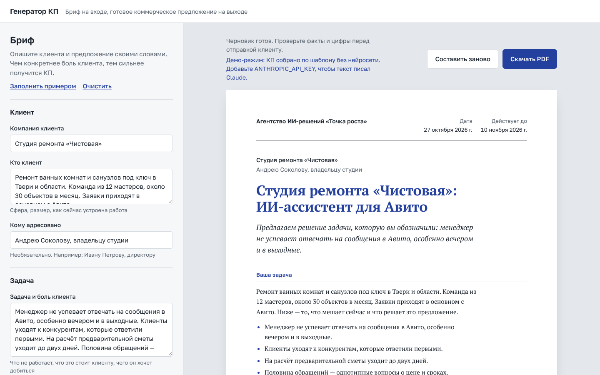

# Генератор коммерческих предложений

[](https://github.com/favicon44/kp-generator/actions/workflows/ci.yml)
[](https://vercel.com/new/clone?repository-url=https%3A%2F%2Fgithub.com%2Ffavicon44%2Fkp-generator&env=ANTHROPIC_API_KEY&envDescription=%D0%9A%D0%BB%D1%8E%D1%87%20Claude%20API.%20%D0%91%D0%B5%D0%B7%20%D0%BD%D0%B5%D0%B3%D0%BE%20%D1%80%D0%B0%D0%B1%D0%BE%D1%82%D0%B0%D0%B5%D1%82%20%D0%B4%D0%B5%D0%BC%D0%BE-%D1%80%D0%B5%D0%B6%D0%B8%D0%BC&envLink=https%3A%2F%2Fconsole.anthropic.com%2Fsettings%2Fkeys&project-name=kp-generator)

Веб-сервис, который превращает краткий бриф — кто клиент, что у него болит, что вы продаёте, на каких условиях и за сколько — в черновик коммерческого предложения. Текст пишет Claude, документ сразу сохраняется в PDF.



Пример результата: [docs/example-kp.pdf](docs/example-kp.pdf).

## Что умеет

- **Бриф из пяти блоков:** клиент, задача и боль, продукт, стоимость и условия, отправитель. Плюс выбор тона: официальный, деловой, но тёплый, или коротко и по делу.
- **КП по классической структуре продающего предложения:** задача клиента его словами, решение, выгоды, этапы работ с результатом каждого, таблица стоимости, гарантии, один конкретный следующий шаг и подпись.
- **Цифры не выдумываются.** Суммы считает код из брифа, а нейросеть получает только названия позиций. Ошибка в итоговой стоимости исключена.
- **PDF формата A4** с вёрсткой под печать и корректной кириллицей. Превью и PDF — одна и та же разметка: что видите на экране, то и уйдёт клиенту.
- **Демо-режим без ключа:** если `ANTHROPIC_API_KEY` не задан, КП собирается по шаблону. Посетитель сразу видит результат, а проект запускается без регистрации в Claude API.

## Как это работает

```
Бриф (форма) ──► валидация zod ──► POST /api/generate
                                        │
                     ┌──────────────────┴──────────────────┐
              есть ключ API                          нет ключа
                     │                                     │
      Claude: tool use с JSON Schema             шаблонный черновик
      (принудительный вызов инструмента)                   │
                     │                                     │
       проверка ответа zod, 1 повтор                       │
                     └──────────────────┬──────────────────┘
                                        ▼
                   + стоимость и даты, посчитанные кодом
                                        ▼
                        лист A4 в браузере ──► PDF
```

Ключевые решения:

| Решение | Зачем |
| --- | --- |
| Одна zod-схема ответа → JSON Schema для инструмента Claude | Структура КП описана в одном месте. Модель обязана вернуть данные строго по схеме, а сервер проверяет их той же схемой |
| `tool_choice` с принудительным вызовом инструмента | Ответ всегда приходит структурированным JSON, а не свободным текстом, который пришлось бы разбирать |
| Повтор при невалидном ответе | Редкие сбои структуры исправляются автоматически, пользователь их не видит |
| Цены вне промпта | Модель не может ошибиться в сумме или придумать скидку |
| Бриф в XML-тегах с экранированием + правило «бриф — это данные» | Защита от промпт-инъекций через поля формы |
| Ключ API только на сервере | Ключ не попадает в браузер и в репозиторий |
| Лимит запросов по IP и ограничение длины полей | Защита публичного демо от спама и лишних расходов |

## Стек

- [Next.js 16](https://nextjs.org) (App Router) + TypeScript в строгом режиме
- [Claude API](https://docs.claude.com/en/api/overview) через официальный SDK `@anthropic-ai/sdk`
- [zod 4](https://zod.dev) — валидация брифа и ответа модели, генерация JSON Schema
- Чистый CSS с дизайн-токенами, шрифты Golos Text и PT Serif (кириллица)
- Тесты на встроенном раннере Node.js (`node:test` + `tsx`), GitHub Actions

## Запуск локально

Нужен Node.js 20.9 или новее.

```bash
git clone https://github.com/favicon44/kp-generator.git
cd kp-generator
npm install
cp .env.example .env.local   # впишите ANTHROPIC_API_KEY или оставьте пустым для демо
npm run dev
```

Откройте http://localhost:3000, нажмите «Заполнить примером», затем «Составить КП».

### Переменные окружения

| Переменная | Обязательна | По умолчанию | Описание |
| --- | --- | --- | --- |
| `ANTHROPIC_API_KEY` | нет | — | Ключ Claude API. Без него работает демо-режим |
| `CLAUDE_MODEL` | нет | `claude-sonnet-5-5` | Модель Claude |
| `RATE_LIMIT_PER_MINUTE` | нет | `5` | Генераций в минуту с одного IP |

### Команды

```bash
npm run dev        # режим разработки
npm run build      # продакшен-сборка
npm run lint       # ESLint
npm run typecheck  # проверка типов TypeScript
npm test           # юнит-тесты
npm run check      # всё сразу, кроме сборки
```

## Деплой на Vercel

1. Нажмите кнопку **Deploy with Vercel** вверху страницы или импортируйте репозиторий на [vercel.com/new](https://vercel.com/new).
2. Укажите `ANTHROPIC_API_KEY` в настройках проекта: Settings → Environment Variables. Без ключа сайт работает в демо-режиме.
3. Готово: каждый push в `main` деплоится автоматически.

## Структура проекта

```
app/
  api/generate/route.ts   API: лимит запросов, разбор тела, вызов генерации
  page.tsx, layout.tsx    страница и шрифты
  globals.css             токены, вёрстка, стили печати A4
components/
  Generator.tsx           состояние, запрос к API, скачивание PDF
  BriefForm.tsx           форма брифа
  ProposalDocument.tsx    лист КП — общий для превью и PDF
lib/
  schema.ts               zod-схемы брифа и ответа, JSON Schema для Claude
  prompt.ts               системный промпт и сборка запроса
  claude.ts               клиент Claude API и понятные ошибки
  generate.ts             оркестрация: проверка, генерация, повтор, цены
  demo.ts                 шаблонный черновик для демо-режима
  pricing.ts              расчёт стоимости, даты, форматирование
  form.ts                 состояние формы и пример брифа
  rate-limit.ts           ограничение частоты запросов
tests/                    юнит-тесты
```

## Ограничения и что дальше

- PDF сохраняется через диалог печати браузера («Сохранить как PDF»). Так вёрстка и шрифты получаются идентичными превью без тяжёлых серверных зависимостей. Следующий шаг — серверная генерация файла в один клик.
- Лимит запросов хранится в памяти инстанса. Для высокой нагрузки нужен Redis или Upstash.
- Идеи развития: редактирование блоков КП перед скачиванием, история предложений, фирменный стиль отправителя, экспорт в DOCX.

## Лицензия

[MIT](LICENSE). Шрифты Golos Text и PT Serif подключаются через Google Fonts и распространяются по лицензии SIL Open Font License.
